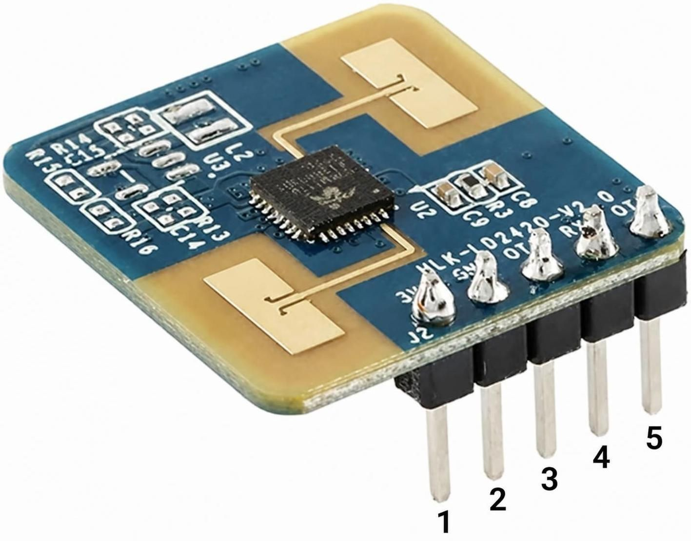
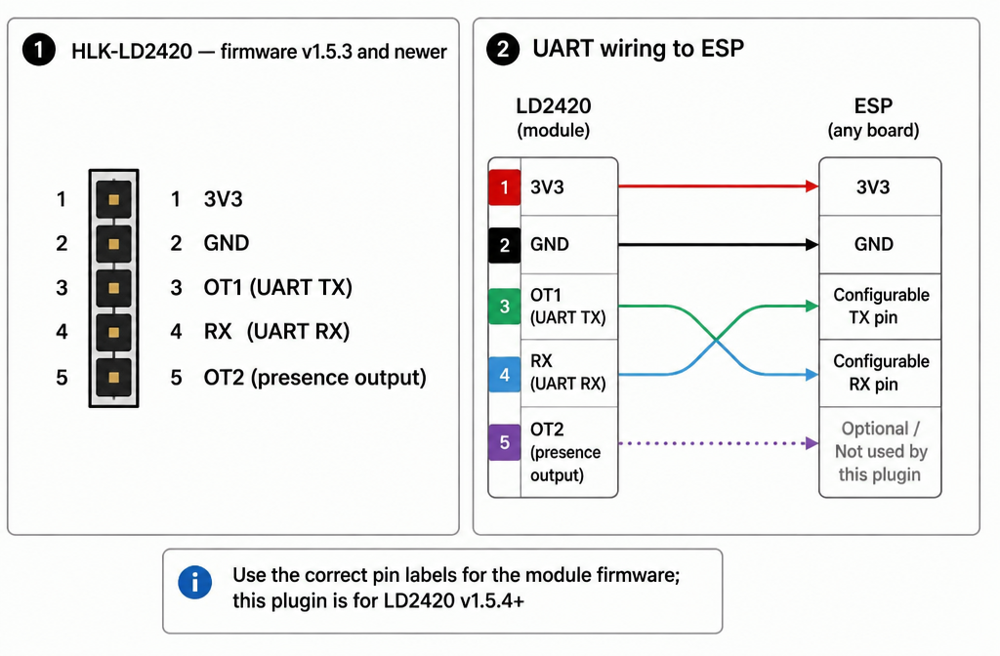

HLK-LD2420 Presence Sensor (Plugin 189)
=======================================

The LD2420 is a 24 GHz radar sensor that detects human presence by analyzing
reflected radar signals. This plugin connects this HLK-LD2420 radar sensor to
ESPEasy over a serial connection. It reports four values: Presence, Distance,
Energy, and Gate.

The plugin is intended for LD2420 firmware version 1.5.4 or newer, because
the firmware-version <= 1.5.3 has no binary energy-frames and report only
presence and distance as text.

Requirements
------------

* An ESPEasy build with Plugin 189 enabled (``USES_P189``).
* An HLK-LD2420 running firmware version 1.5.4 or newer.
* A serial connection supported by the selected ESP board.
* A baud rate configured identically on the LD2420 and in the plugin.

Configuration
-------------

Add a device and select ``Presence - LD2420`` (Plugin 189). Configure the
serial port and its RX and TX pins using the options available for your ESP
board. The plugin uses a non-CDC serial port.

Select the baud rate used by the sensor:

* ``115200`` (default and the required setting for firmware 1.5.4 or newer)
* ``256000``

The LD2420 and ESPEasy must use the same baud rate.

Detection settings
~~~~~~~~~~~~~~~~~~

The plugin configuration provides these LD2420 detection settings:

``Minimum Gate``
  Minimum gate for detection (0 to 15)

``Maximum Gate``
  Maximum gate for detection (0 to 15)

``Timeout``
  Timeout for reverting to "no presence" (1 to 65535)

Gate thresholds
~~~~~~~~~~~~~~~

The configuration form provides ``Moving`` and ``Still`` threshold fields
for each gate, numbered 0 through 15. Each threshold accepts values from
0 to 65535.

1. **Moving Threshold exceeded:**
   The radar signal energy exceeds the movement threshold. The sensor
   detects movement and sets the presence status to **ON**. A new
   detection resets the timeout.

2. **Still Threshold undershot:**
   The radar signal energy falls below the threshold for maintaining
   stationary presence. The sensor may no longer reliably detect the
   person. However, the presence status does not immediately switch
   to **OFF**; the timeout continues running.

3. **Timeout expired:**
   If no new relevant radar detection occurs before the timeout expires,
   the presence status switches to **OFF**. If a new relevant detection
   occurs before the timeout expires, the countdown is reset.

**Important:**
The Moving and Still thresholds are not simple ON/OFF switches for
presence. They influence whether the LD2420 detects movement or
maintains stationary presence. The exact evaluation is handled
internally by the sensor's firmware.

Wiring
------

Connect the sensor's UART transmit signal to the ESP's configured RX pin,
and the sensor's UART receive signal to the configured TX pin. Connect
ground to ground and provide the supply voltage required by the specific
LD2420 module. Check the labels and electrical requirements of the module
in use before wiring; this plugin source does not specify a module
connector pinout or supply voltage.

The TX and RX signal lines are crossed: sensor TX goes to ESP RX, and
sensor RX goes to ESP TX. Select RX and TX pins supported by the ESP board
and the chosen ESPEasy serial port.

Output values
-------------

The plugin exposes four integer values, with zero decimal places:

``Presence``
  Presence-related value reported by the sensor.

``Distance``
  Distance-related value reported by the sensor.

``MaxEnergy``
  Maximum energy-value of all Gates.

``MaxEnergyGate``
  Gate# with the maximum energy-value.

Commands
--------

Run these commands from **Tools > Command**:

``ld2420,readconfig``
  Read the sensor configuration.

``ld2420,apply``
  Apply the configured sensor settings.

``ld2420,factoryreset``
  Restore the sensor's factory configuration.

``ld2420,restart``
  Restart the sensor.

``ld2420,logenergy``
  Output all 16 energy values in the log.

``ld2420,logversion``
  Output the sensor firmware-version in the log.

Troubleshooting
---------------

No readings
  Check that the task is enabled, the selected serial port and GPIO pins
  are supported, and the UART wires are crossed correctly.

Communication problems
  Confirm that the baud rate selected in ESPEasy matches the sensor's
  baud rate. Check the wiring, common ground, and power requirements of
  the module.

Unexpected detection behavior
  Review the minimum and maximum gates, timeout, and moving/still
  thresholds. Use ``ld2420,readconfig`` to inspect the sensor
  configuration.

Most error causes are logged.

Implementation notes
--------------------

The plugin registers as device number 189 and processes sensor data in
the ESPEasy 10 Hz scheduler callback. It supports the ESPEasy timer,
formula, send-data, and plugin-statistics options.
